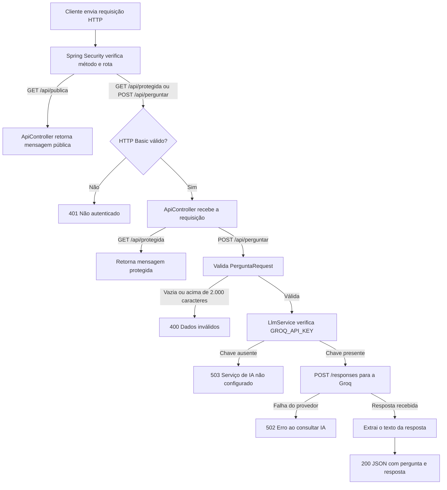

# Fluxo da requisição

Este diagrama acompanha o caminho desde a chamada HTTP até a resposta da API ou da Groq.



## Onde cada etapa acontece

| Etapa | Arquivo |
|---|---|
| Regras públicas e protegidas | `src/main/java/br/com/uc4/apillm/config/SecurityConfig.java` |
| Rotas HTTP | `src/main/java/br/com/uc4/apillm/controller/ApiController.java` |
| Validação da pergunta | `src/main/java/br/com/uc4/apillm/dto/PerguntaRequest.java` |
| Chamada HTTP à Groq e leitura da resposta | `src/main/java/br/com/uc4/apillm/service/LlmService.java` |
| Conversão de erros em respostas HTTP | `src/main/java/br/com/uc4/apillm/exception/ApiExceptionHandler.java` |

## Exemplo da rota de IA

Requisição `POST /api/perguntar` autenticada:

```json
{
  "pergunta": "O que é orientação a objetos?"
}
```

Resposta esperada:

```json
{
  "pergunta": "O que é orientação a objetos?",
  "resposta": "...texto gerado pela LLM..."
}
```
